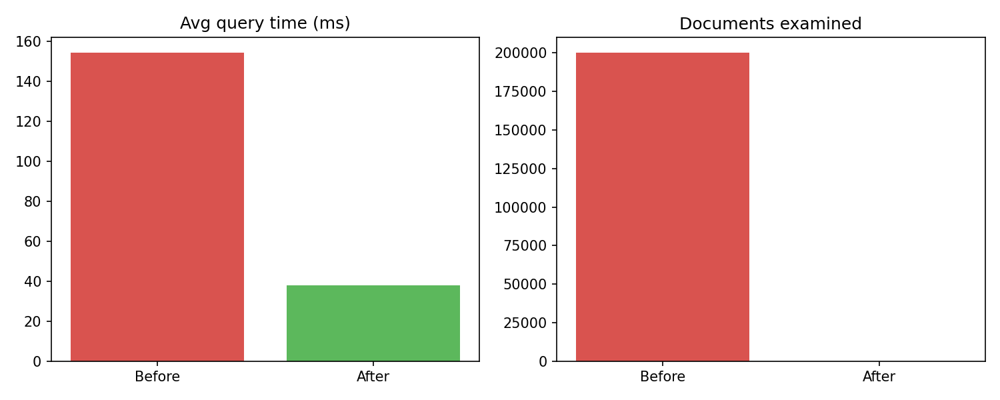
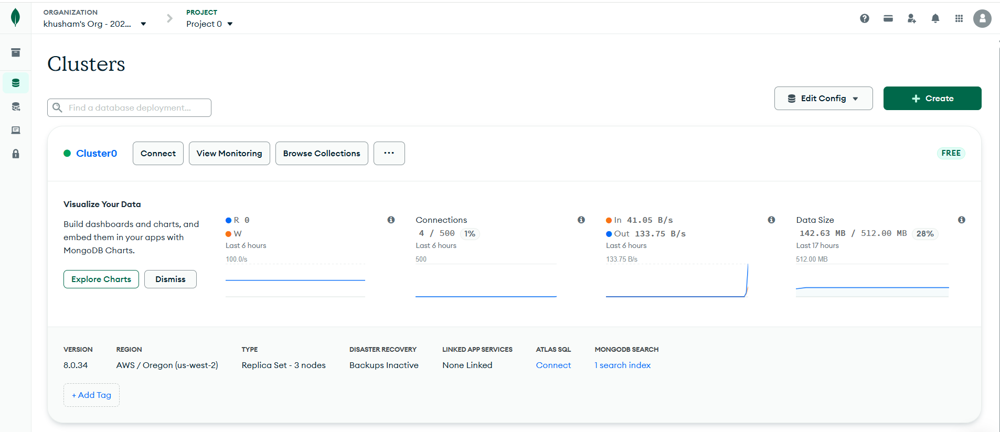
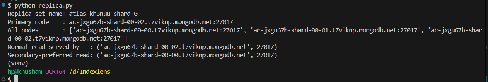
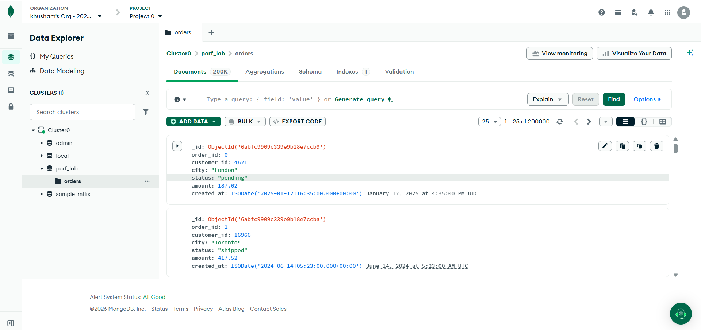
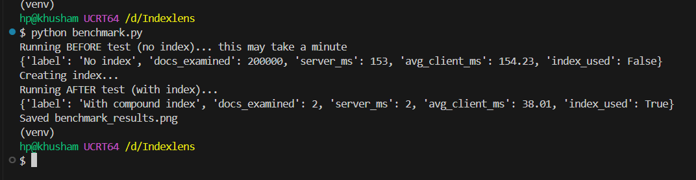

# IndexLens

Exploring a 3-node MongoDB Atlas replica set and measuring how indexing changes query performance.

## Tech
Python, PyMongo, MongoDB Atlas, Matplotlib

## What I did
- Deployed a free-tier MongoDB Atlas cluster, which runs as a 3-node replica set (1 primary, 2 secondaries)
- Generated 200,000 sample order documents with Python
- Checked replica set status and sent reads to a secondary node
- Benchmarked one query before and after adding a compound index on `customer_id`, `status`, `created_at`

## Results

| | Before index | After index |
|---|---|---|
| Documents examined | 200,000 | 2 |
| Server query time | 153 ms | 2 ms |
| Avg time in Python | 154.23 ms | 38.01 ms |
| Plan | Full collection scan | Index scan |

## Screenshots

**Atlas cluster: 3-node replica set**

**Replica set and read routing**

**200,000 documents loaded**

**Benchmark output**
